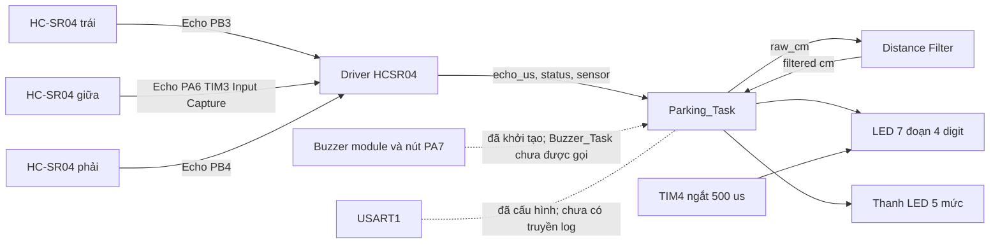

# D07

## Cấu hình clock

- Nguồn HSE được bật và đưa vào PLL.
- PLL nhân 9; SYSCLK và HCLK là **72 MHz**.
- AHB chia 1; APB1 chia 2 (**36 MHz**); APB2 chia 1 (**72 MHz**).
- Flash latency là 2 wait states.

## 1. Phần cứng và công cụ

- MCU: **STM32F103C8T6**, cấu hình project cho dòng STM32F103xB.
- Cảm biến: **3 HC-SR04**, lần lượt trái, giữa, phải.
- Hiển thị: LED bảy đoạn 4 digit và thanh 5 LED mức.
- Ngoại vi đã cấu hình: TIM1, TIM2, TIM3, TIM4 và USART1.
- Firmware dùng STM32 HAL/CMSIS được đặt trong `Drivers/`.
- Cấu hình STM32CubeMX: `D07.ioc`; project Keil µVision: `MDK-ARM/D07.uvprojx`.

## 2. Sơ đồ khối và luồng dữ liệu



`main()` khởi tạo GPIO, TIM2–TIM4, TIM1, USART1, sau đó gọi `Parking_Init()` và `Buzzer_Init()`. Vòng lặp chính gọi liên tục `Parking_Task()`. Hàm này quản lý phép đo, lấy kết quả, chuyển `echo_us` thành cm, gọi bộ lọc, cập nhật LED bảy đoạn và thanh LED mức.

Driver lần lượt kích hoạt cảm biến trái, giữa, phải. Khoảng thời gian tối thiểu giữa hai lần kích hoạt chung là 70 ms; vì vậy một cảm biến được kích hoạt danh định khoảng 210 ms một lần khi kết quả được ứng dụng đọc bình thường. Driver có timeout Echo 35 ms và chấp nhận độ rộng xung 100–25.000 µs. Kết quả trả về có mã cảm biến, nhưng tầng ứng dụng hiện chưa dùng mã này để lưu bộ lọc riêng cho từng hướng: ba cảm biến đang dùng chung một bộ lọc và một giá trị hiển thị.

## 3. API giữa các module

| Header | API | Vai trò / dữ liệu |
|---|---|---|
| `parking_app.h` | `HAL_StatusTypeDef Parking_Init(void)` | Khởi tạo display, bộ lọc, LED mức và driver HC-SR04; bắt đầu ngắt TIM4. |
|  | `void Parking_Task(void)` | Gọi từ vòng lặp chính; điều phối đo, xử lý kết quả và cập nhật display/LED mức. |
| `hcsr04.h` | `HAL_StatusTypeDef HCSR04_Init(void)` | Khởi tạo driver và trạng thái đo. |
|  | `void HCSR04_Task(void)` | Điều phối chu kỳ đo và timeout; cần được gọi lặp trong ứng dụng. |
|  | `uint8_t HCSR04_GetResult(HCSR04_Result *result)` | Trả 1 khi có kết quả mới và chép `echo_us`, `status`, `sensor` vào struct; sau khi đọc thì chuyển sang cảm biến kế tiếp. Trả 0 nếu chưa có kết quả hoặc con trỏ NULL. |
|  | `void HCSR04_CaptureCallback(TIM_HandleTypeDef *htim)` | Xử lý Input Capture TIM3 cho cảm biến giữa; được chuyển tiếp từ HAL callback trong `main.c`. |
|  | `void HCSR04_EXTI_Callback(uint16_t GPIO_Pin)` | Xử lý cạnh Echo hai cảm biến bên; được chuyển tiếp từ HAL GPIO EXTI callback. |
|  | `HCSR04_Status`, `HCSR04_Result` | Các trạng thái gồm OK, TIMEOUT, ECHO_HIGH, BAD_PULSE, HW_ERROR. Struct có `echo_us`, `status`, `sensor`. |
| `distance_filter.h` | `void DF_Reset(void)` | Xóa trạng thái cửa sổ lọc và bộ đệm trung bình. |
|  | `uint8_t DF_Push(float raw_cm, float *filtered_cm, uint8_t *outlier)` | Nhận khoảng cách thô cm; trả 0 khi đầu vào/đầu ra không hợp lệ hoặc chưa đủ 5 mẫu, trả 1 khi có kết quả lọc. Cờ `outlier` báo mẫu vượt ngưỡng nhưng mẫu vẫn được đưa vào cửa sổ. |
| `display4.h` | `void Display4_Init(void)` | Khởi tạo trạng thái khung hiển thị. |
|  | `void Display4_ShowTenths(uint16_t cm_x10)` | Cập nhật giá trị hiển thị, đơn vị 0,1 cm; ví dụ `123` hiển thị 12,3 cm. |
|  | `void Display4_ShowInvalid(void)` | Đặt khung hiển thị trạng thái không hợp lệ. |
|  | `void Display4_ScanISR(void)` | Thực hiện một pha quét; được gọi từ ngắt TIM4 mỗi 500 µs. Hai pha cho mỗi digit, bốn digit. |
| `level_led.h` | `void LevelLED_Init(void)` | Khởi tạo và tắt thanh LED mức. |
|  | `void LevelLED_Task(uint8_t valid, uint16_t cm_x10)` | Cập nhật 5 LED theo cờ hợp lệ và khoảng cách cm × 10. |
|  | `uint8_t LevelLED_Level(void)` | Trả về mức LED hiện tại từ 0 đến 5. |
| `buzzer.h` | `HAL_StatusTypeDef Buzzer_Init(void)` | Đặt trạng thái PWM ban đầu tắt, khởi tạo trạng thái nút và chạy PWM TIM1. |
|  | `void Buzzer_Task(uint8_t valid, uint16_t distance_x10)` | Tính mức còi, nhịp cảnh báo và đọc nút. Hàm hiện chưa được gọi trong `main()` hoặc `Parking_Task()`. |
|  | `buzzer_on`, `buzzer_muted` | Các biến trạng thái `volatile uint8_t` được khai báo extern trong header. |
| `usart.h` | `void MX_USART1_UART_Init(void)` | Khởi tạo USART1. Trong ứng dụng hiện chưa có hàm truyền log. |

## 4. Bảng chân MCU và timer

| Chân | Chức năng trong firmware | Cấu hình / ghi chú |
|---|---|---|
| PA0 | TRIG cảm biến trái | GPIO output; driver tạo xung bằng phần mềm tham chiếu CNT TIM3. |
| PB3 | ECHO cảm biến trái | EXTI3 hai cạnh, pull-down; đọc CNT TIM3 trong callback. |
| PA1 / TIM2_CH2 | TRIG cảm biến giữa | PWM2, One-Pulse Mode; cấu hình PSC=71, ARR=12, CCR2=1. |
| PA6 / TIM3_CH1 | ECHO cảm biến giữa | Input Capture; bắt cạnh lên rồi cạnh xuống. |
| PA15 | TRIG cảm biến phải | GPIO output; driver tạo xung bằng phần mềm tham chiếu CNT TIM3. |
| PB4 | ECHO cảm biến phải | EXTI4 hai cạnh, pull-down; đọc CNT TIM3 trong callback. |
| PA2–PA5, PB11 | LED mức 1–5 | GPIO output, mức HIGH bật; thanh LED tích lũy. |
| PB0, PB1, PB5–PB10 | Segment a,b,c,d,e,f,g,dp | GPIO output, mức LOW bật. |
| PB12–PB15 | Chọn digit 1–4 | GPIO output, mức LOW chọn digit. |
| PA7 | Nút mute | GPIO input pull-up; phần mềm đổi mute khi mức HIGH ổn định 30 ms, tức lúc nhả nút nếu nút nối xuống GND. Task đọc nút hiện chưa được gọi. |
| PA8 / TIM1_CH1 | Còi | PWM1, cực tính LOW; module khởi tạo PWM nhưng task cảnh báo chưa được gọi. |
| PA9 / PA10 | USART1 TX / RX | TX alternate-function push-pull; RX input no-pull; 115200 baud, 8N1. |
| PA13 / PA14 | SWDIO / SWCLK | SWD được giữ hoạt động để nạp và debug. Firmware tắt JTAG để dùng PA15, PB3, PB4 cho cảm biến. |
| PD0 / PD1 | HSE OSC_IN / OSC_OUT | Chân dao động ngoài theo cấu hình clock. |

### Cấu hình timer

| Timer | Cấu hình chính | Vai trò trong firmware |
|---|---|---|
| TIM1 | PSC=71, ARR=499, PWM1 CH1, polarity LOW | PWM 2 kHz trên PA8 cho module còi. |
| TIM2 | PSC=71, ARR=12, PWM2 CH2, CCR2=1, OPM | Phát Trigger cho cảm biến giữa trên PA1; chu kỳ bộ đếm 13 µs, mức cao danh định khoảng 12 µs theo chế độ PWM2. |
| TIM3 | PSC=71, ARR=65535, CH1 Input Capture | 1 tick = 1 µs; Input Capture chỉ dùng Echo giữa. Bộ đếm cũng làm mốc thời gian cho hai Trigger bên và đo Echo bên qua EXTI. |
| TIM4 | PSC=71, ARR=499, base interrupt | Ngắt mỗi 500 µs; gọi quét display. Hai pha × bốn digit tạo khung 4 ms, khoảng 250 Hz. |

## 5. Đấu nối phần cứng

### Nguồn và debug

1. Cấp nguồn theo đúng yêu cầu của board STM32 và từng module; nối GND chung giữa MCU và các module.
2. Nạp/debug bằng SWD: ST-Link SWDIO tới PA13, SWCLK tới PA14, GND tới GND. Chân nguồn mục tiêu đấu theo cấu hình ST-Link và board đang sử dụng.
3. Clock firmware yêu cầu HSE qua PLL ×9 để tạo SYSCLK 72 MHz. Kiểm tra board có nguồn HSE tương thích với cấu hình trước khi chạy.
4. Firmware giải phóng PA15, PB3 và PB4 bằng cách tắt JTAG, đồng thời giữ SWD hoạt động.

### HC-SR04

| Cảm biến | TRIG MCU | ECHO MCU |
|---|---|---|
| Trái | PA0 | PB3 (EXTI3) |
| Giữa | PA1 (TIM2_CH2) | PA6 (TIM3_CH1 Input Capture) |
| Phải | PA15 | PB4 (EXTI4) |

Nối VCC/GND theo thông số module HC-SR04 và tạo GND chung với MCU. Kiểm tra mức điện áp Echo và khả năng chịu mức logic của board/mạch đầu vào trước khi kết nối. Firmware không mô tả mạch chia áp hoặc level shifter.

### LED 7 đoạn, LED mức và còi

- Nối các segment a,b,c,d,e,f,g,dp lần lượt tới PB0, PB1, PB5, PB6, PB7, PB8, PB9, PB10.
- Nối chân chọn bốn digit lần lượt tới PB12, PB13, PB14, PB15. Driver xuất mức LOW để bật segment và chọn digit; loại LED và mạch transistor thực tế phải phù hợp với sơ đồ lắp.
- Nối LED mức 1–4 tới PA2–PA5, LED mức 5 tới PB11. Dùng điện trở hạn dòng cho mỗi LED.
- Nút PA7 dùng pull-up nội; nếu dùng nút nhấn để GND, trạng thái nhấn là LOW và nhả là HIGH. Logic hiện đổi mute khi nhận trạng thái HIGH ổn định 30 ms.
- Tín hiệu còi PWM nằm trên PA8/TIM1_CH1.
- USART1 dùng PA9 (TX) và PA10 (RX). Khi nối USB-UART, nối TX với RX chéo và dùng GND chung. Chương trình hiện chưa phát log.

## 6. Cấu hình ứng dụng

`Core/Inc/parking_config.h` khai báo:

```c
#define PARKING_TEMP_C 20.0f
#define PARKING_CAL_A 1.0f
#define PARKING_CAL_B_CM 0.0f
```

- Nhiệt độ được nhập cố định 20 °C, không lấy từ cảm biến nhiệt.
- Khoảng cách thô được tính bằng `echo_us * (331.3 + 0.606 * PARKING_TEMP_C) / 20000.0`.
- Hiệu chuẩn có dạng `d_cal = A * d_filtered + B`; 
- Bộ lọc chấp nhận khoảng cách thô từ 2 đến 400 cm. Cửa sổ median cần đủ 5 mẫu. Sau đó chương trình so độ lệch của mẫu mới với ngưỡng lớn hơn giữa 3 cm và 15% median. Mẫu bị đánh dấu ngoại lai vẫn được đưa vào cửa sổ; đầu ra là trung bình tối đa 3 giá trị median gần nhất.
- Khi phép đo báo lỗi, khoảng cách ngoài miền hợp lệ hoặc quá 300 ms chưa có mẫu thô tốt, ứng dụng reset bộ lọc, đánh dấu dữ liệu không hợp lệ và hiển thị dấu gạch.
- Các ngưỡng LED mức là 100, 80, 60, 40 và 20 cm. Mã còi có cùng các mức nhưng chưa được gọi từ ứng dụng.

## 7. Cấu trúc thư mục

```text
D07/
├── Core/
│   ├── Inc/       Header, cấu hình và khai báo API
│   └── Src/       Mã nguồn ứng dụng, HAL callback và cấu hình ngoại vi
├── Drivers/       STM32 HAL và CMSIS
├── EWARM/         Tệp dự án IAR
├── MDK-ARM/       Tệp dự án Keil µVision và đầu ra build
├── .mxproject     Metadata dự án STM32CubeMX
└── D07.ioc        Cấu hình STM32CubeMX
```

Các module ứng dụng chính trong `Core/Src` gồm `hcsr04.c`, `distance_filter.c`, `parking_app.c`, `display4.c`, `level_led.c`, `buzzer.c` và `usart.c`; header tương ứng nằm trong `Core/Inc`.

## 8. Build và nạp

1. Mở `MDK-ARM/D07.uvprojx` bằng Keil µVision.
2. Chọn target đã cấu hình trong project và kiểm tra đường dẫn thư viện/Device Pack nếu Keil báo thiếu cấu hình.
3. Chọn **Build** để biên dịch.
4. Kết nối ST-Link qua SWD theo cấu hình board, chọn **Download** để nạp firmware.
5. Có thể mở `D07.ioc` bằng STM32CubeMX để xem cấu hình ngoại vi. Trước khi sinh lại code, nên rà soát vùng người dùng trong `Core/Src` và các module riêng.

Project có sẵn thư mục đầu ra build trong `MDK-ARM`; sự tồn tại của file build không xác nhận firmware hiện tại đã được nạp hoặc kiểm thử trên phần cứng.

## Sơ đồ cấu hình ngoại vi

```text
HSE ──► PLL ×9 ──► SYSCLK/HCLK 72 MHz
                       │
                       ├── TIM1_CH1 PWM 2 kHz ──► PA8 (buzzer module)
                       ├── TIM2_CH2 One-Pulse ──► PA1 (TRIG giữa)
                       ├── TIM3_CH1 Input Capture ◄── PA6 (ECHO giữa)
                       ├── TIM3 CNT 1 µs ──► thời gian Trigger/Echo hai cảm biến bên
                       ├── TIM4 interrupt 500 µs ──► quét LED 7 đoạn
                       └── USART1 115200 8N1 ──► PA9 TX / PA10 RX

PA0  = TRIG trái       PB3  = ECHO trái / EXTI3
PA15 = TRIG phải       PB4  = ECHO phải / EXTI4
PA13 = SWDIO           PA14 = SWCLK
PD0  = OSC_IN          PD1  = OSC_OUT
```

## Bảng chân GPIO và timer

Bảng chân đầy đủ và hướng dẫn đấu nối nằm ở mục **4. Bảng chân MCU và timer** và **5. Đấu nối phần cứng**. Tóm tắt ánh xạ tín hiệu ứng dụng:

| Chân MCU | Tín hiệu | Logic trong firmware |
|---|---|---|
| PA0 / PB3 | TRIG/ECHO trái | Trigger GPIO; Echo EXTI hai cạnh |
| PA1 / PA6 | TRIG/ECHO giữa | TIM2_CH2 One-Pulse; TIM3_CH1 Input Capture |
| PA15 / PB4 | TRIG/ECHO phải | Trigger GPIO; Echo EXTI hai cạnh |
| PA2–PA5 / PB11 | LED mức 1–5 | HIGH bật, tích lũy theo ngưỡng |
| PB0, PB1, PB5–PB10 | Segment a–g, dp | LOW bật |
| PB12–PB15 | Chọn digit 1–4 | LOW bật digit |
| PA7 | Nút mute | Input pull-up; task hiện chưa được gọi |
| PA8 | Buzzer PWM | TIM1_CH1, PWM polarity LOW; task hiện chưa được gọi |
| PA9 / PA10 | USART1 TX/RX | 115200, 8N1; chưa có truyền log |


